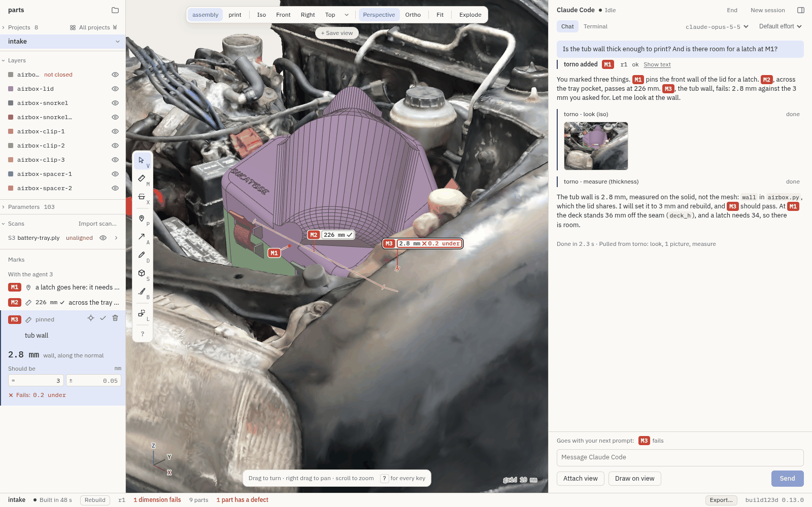
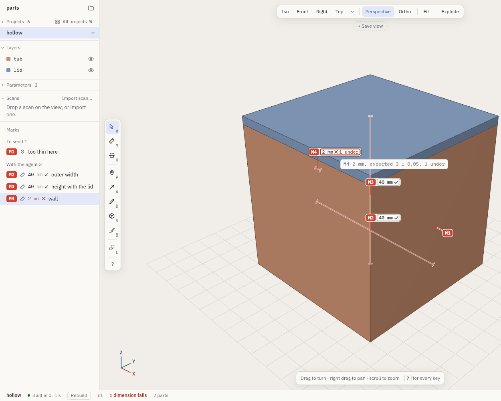
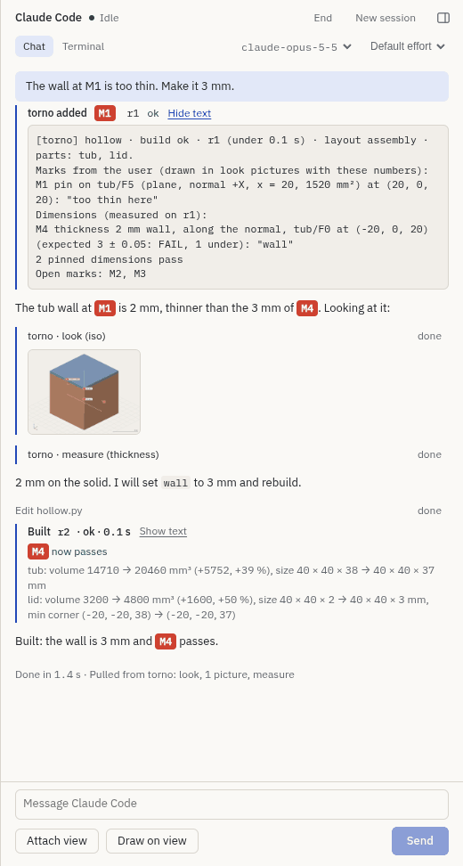
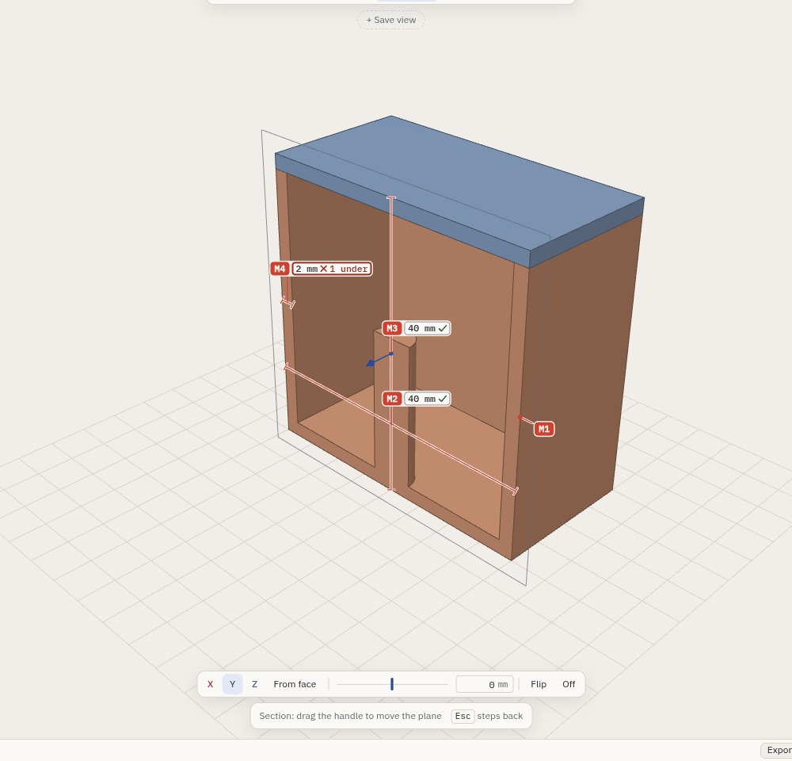
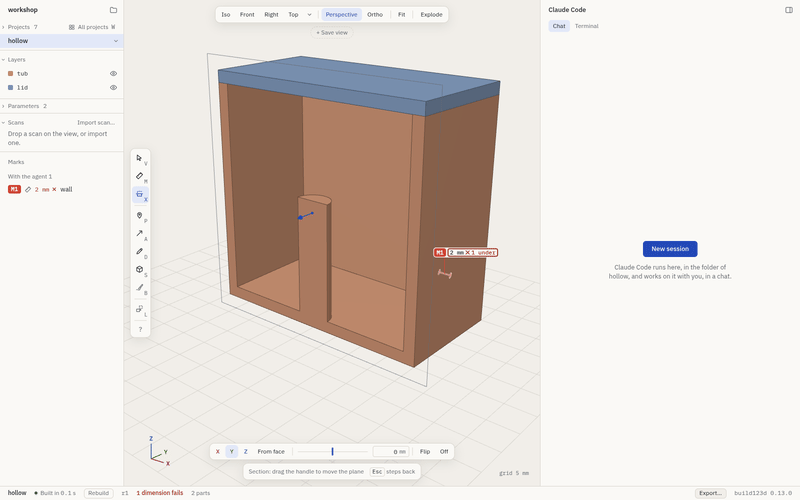

<p align="center">
  
</p>

<h1 align="center">torno</h1>

<p align="center">
  A desktop workbench for making CAD parts with an AI coding agent.<br>
  You point at the part. The agent writes the code. torno builds it every time you save.
</p>

<p align="center">
  <a href="#getting-started">Getting started</a> ·
  <a href="docs/manual.md">Manual</a> ·
  <a href="#how-it-works">How it works</a> ·
  <a href="#contributing">Contributing</a>
</p>

<p align="center">
  <picture>
    <source media="(prefers-color-scheme: dark)" srcset="docs/images/hero-dark.png">
    
  </picture>
</p>

> [!NOTE]
> torno is new and early. It is developed on Linux (Arch, Wayland) and also runs on macOS, which has seen less use. Expect rough edges,
> and please [open an issue](https://github.com/luisg0nc/torno/issues) when you find one.

## Why torno

Coding agents are good at writing [build123d](https://github.com/gumyr/build123d) models, the Python CAD library
on top of OpenCascade. Two things get in the way. The agent can't see what it made, and it's hard for you to
tell it *which* face is wrong, or by how much.

torno fixes both. It runs [Claude Code](https://docs.anthropic.com/en/docs/claude-code) next to a live 3D view
of the model. You pin a note to a face, measure a wall or draw on the view, and the agent gets exactly what you
pointed at: the face's ref, the exact measured value, your note. The agent also gets tools to look at the model,
measure it and cut sections through it, so it can check its own work before it hands it back.

torno is not a modeller. It has no sketcher, no feature tree and no way to edit a solid by hand. The model is
the Python file, and torno shows it.

<p align="center">
  
</p>

## Features

- **Live builds.** Every save rebuilds the model and redraws it. When a build fails, the last good parts stay on
  screen and the traceback is one click away. A failed fillet tells you which edges and what radius would work.
- **Point, don't describe.** Pins, arrows, strokes, shapes and picks on faces and edges, each with a note. The
  agent gets them with your next prompt as refs like `lid/F12`, never as vague words.
- **Exact numbers.** Distances, angles, radii and wall thickness are measured on the B-rep, not on the mesh.
  Give a dimension the value it should be and it says *passes* or *fails* after every build.
- **The agent sees what you see.** The agent gets MCP tools of its own: `look` (a picture of your view, marks
  included), `measure`, `section`, `check` (overlaps and printability), `diff` between builds, `try_fillet`
  and more.
- **Section, explode, saved views.** Cut through the parts, pull an assembly apart, keep a camera under a
  name.
- **Scans.** Import a phone or scanner mesh of the place the part has to fit, align it, and check clashes and
  deviation against it. torno always marks scan numbers as approximate.
- **Start from what you have.** A new project can start from a description, photos, doodles, scans and other
  projects in the workspace. Claude gets all of it with its first prompt.
- **Export.** A single HTML file anyone can open in a browser without installing anything, or STEP, STL and 3MF.
- **Local.** torno itself uploads nothing. The agent is your own `claude`, under your own login, and torno
  leaves its settings alone. In your folders, torno writes only under `<project>/.torno/`.

<table>
  <tr>
    <td></td>
    <td></td>
    <td></td>
  </tr>
  <tr>
    <td align="center">Marks and dimensions</td>
    <td align="center">The agent's view</td>
    <td align="center">Section</td>
  </tr>
</table>

## How it works

<p align="center">
  
</p>

<p align="center">
  
</p>

A **workspace** is a folder of **projects**. Each project is a folder with one build123d model in it:

```
projects/
├── bracket/
│   └── bracket.py
└── hollow/
    └── hollow.py
```

A model gives its parts as a dict, or as `make_<part>()` functions, or as module-level shapes:

```python
from dataclasses import dataclass
from build123d import Box, Cylinder, Pos

@dataclass(frozen=True)
class Params:
    side: float = 40
    wall: float = 2

def assembly(p):
    inner, height = p.side - 2 * p.wall, p.side - p.wall
    tub = Pos(0, 0, height / 2) * Box(p.side, p.side, height)
    tub -= Pos(0, 0, p.wall + inner / 2) * Box(inner, inner, inner)
    tub += Pos(0, 0, p.wall + 10) * Cylinder(3, 20)
    lid = Pos(0, 0, height + p.wall / 2) * Box(p.side, p.side, p.wall)
    return {"tub": tub, "lid": lid}
```

The app is Electron and three.js. The kernel is a Python package that loads models and tessellates them in
forked workers. Each project gets its own Claude Code session, in the project's folder, connected to torno's MCP
server on `127.0.0.1`. See [Projects and builds](docs/manual.md#projects-and-builds) for the full rules.

## Getting started

### Requirements

- Linux or macOS
- Node.js 22.12 or later, and pnpm 10
- [uv](https://docs.astral.sh/uv/) (it fetches Python 3.11 or 3.12 if you have neither)
- [Claude Code](https://docs.anthropic.com/en/docs/claude-code) (`claude`) on your `PATH`, logged in

torno checks all of this on its first screen, under "Ready to work", and says what's missing. The first build
sets up torno's own Python environment with build123d (about 900 MB, once). If your workspace has its own
`pyproject.toml`, torno uses that environment instead and never changes it. Run `uv sync` there once yourself.
More in [Requirements](docs/manual.md#requirements).

### Install

```sh
git clone https://github.com/luisg0nc/torno.git
cd torno
pnpm install
```

### Run

```sh
scripts/torno ~/projects    # open a folder as the workspace
scripts/torno               # the workspace you opened last, or the first screen
```

The launcher rebuilds the app when the sources change, so `git pull` and run it again. On the first screen,
**Open the example** opens a few small projects in a temporary copy, so you can try everything without touching
your own files.

On Linux, `scripts/torno --install-desktop` adds torno to your application launcher. On macOS,
`pnpm dist:mac` builds `torno.app` in `app/dist/` (signed ad hoc, not notarized). More in
[Run](docs/manual.md#run).

### Your first five minutes

The manual has a [walk-through](docs/manual.md#five-minutes-with-torno) that takes you through building,
turning, exploding, pinning, measuring, cutting and asking the agent, on the test models.

## Documentation

- **[The manual](docs/manual.md)**, the reference for everything torno does. The parts most people need:
  - [The agent](docs/manual.md#the-agent): the chat, what Claude Code is given and told, the
    [tools](docs/manual.md#tools)
  - [Marks](docs/manual.md#marks) and [measuring](docs/manual.md#measuring-and-dimensions)
  - [Scans](docs/manual.md#scans) and [export](docs/manual.md#export)
  - [Keys](docs/manual.md#keys), [files torno writes](docs/manual.md#files-torno-writes),
    [troubleshooting](docs/manual.md#troubleshooting)
- **[The design](docs/superpowers/specs/2026-10-08-torno-design.md)**, why torno is built the way it is.

## Contributing

Issues and pull requests are welcome. torno is young, so for anything bigger than a fix, please open an issue
first to talk it over. [CONTRIBUTING.md](CONTRIBUTING.md) covers setting up, where things are, the rules the code
holds to, and the tests.

## License

Copyright 2026 the torno authors.

Licensed under the [Apache License, Version 2.0](LICENSE).
